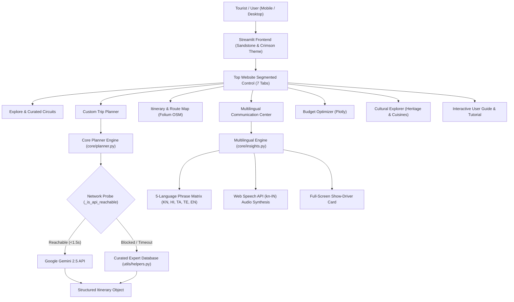

# 🏛️ KannadaYatra AI - Intelligent Travel Companion for Karnataka

> **Kannada Digital Innovation Hackathon 2026**  
> **Problem Statement 6:** AI Travel Planner for Karnataka  
> **Repository:** https://github.com/pgovila/KannadaYatra-AI---Intelligent-Travel-Companion-for-Karnataka

---

## 🌟 Executive Overview

**KannadaYatra AI** is an intelligent, hyper-personalized travel companion engineered specifically for Karnataka. Unlike generic LLM itinerary generators that output hallucinated routes and tourist-trap recommendations, KannadaYatra AI blends **living cultural context**, an **interactive multilingual communication engine** (Kannada, Hindi, Tamil, Telugu, English), **real-world transit feasibility** (calibrated against official KSRTC bus networks and KSTDC routes), and **secret local darshini culinary trails**.

Built with a light, warm sandstone visual canvas, authentic Karnataka State royal emblems (the Gandaberunda seal), and high-contrast accessibility, it empowers travelers from across India and around the globe to explore Karnataka **like a local, not just a tourist**.

---

## 🎯 Target Audience & Real-World Use Cases

- 🌍 **Domestic & Interstate Tourists:** Travelers visiting from Tamil Nadu, Andhra Pradesh, Telangana, Maharashtra, and North India who need seamless communication in their native language while learning spoken Kannada.
- 🏛️ **Heritage & Cultural Explorers:** Travelers seeking Hoysala architecture, Vijayanagara stone empires, Chalukyan cave temples, and living festival traditions.
- 🎒 **Backpackers & Adventure Seekers:** Trekkers climbing Western Ghats peaks (Mullayanagiri, Kudremukh) or exploring Gokarna's coastal trails on a student budget.
- 💼 **Business & Bleisure Visitors:** Bengaluru IT professionals and delegates seeking curated weekend getaways.

---

## ✨ Key System Capabilities

### 1. ⚡ Dual-Engine Itinerary Synthesis
- **Generative AI Engine (Google Gemini 2.5):** Synthesizes hyper-personalized daily schedules with time allocations, transit logistics, and contextual tips when online.
- **Instant Curated Expert Engine (100% Offline, ~6ms Response):** Hand-crafted by local historians and seasoned travelers across Karnataka's top 29 destinations. If API connectivity is unavailable, the app instantly falls back to validated regional itineraries without delay.
- **4 Iconic 1-Click Circuits:**
  - 👑 *Royal Mysore & Hoysala Stone Lace Trail* (Mysore Palace, Chamundi Hills, Srirangapatna, Belur, Halebidu)
  - ☕ *Western Ghats Cloud & Aroma Trail* (Chikmagalur, Mullayanagiri, Coorg, Sakleshpur)
  - 🌊 *Karavali Coast & Temple Odyssey* (Gokarna, Murdeshwar, Udupi, Mangalore)
  - 🏛️ *Vijayanagara & Chalukyan Stone Empires* (Hampi, Badami, Pattadakal, Aihole, Bijapur)

### 2. 🗺️ Watermark-Free Interactive Route Map
- Built using **Folium & Leaflet OpenStreetMap** without external API keys or vendor watermarks.
- Renders numbered sequence markers, color-coded by region, and plots geographic travel lines connecting each day's stops.
- Includes quick-glance destination cards with verified photographs, crowd level indicators, optimal visiting hours, and local food tips.

### 3. 🗣️ Multilingual Tourist Communication Center (5 Languages)
- **Supported Languages:** **Kannada (ಕನ್ನಡ)**, **Hindi (हिन्दी)**, **Tamil (தமிழ்)**, **Telugu (తెలుగు)**, and **English (🇬🇧)**.
- **Global UI Localization:** The top navigation bar, headers, and action buttons adapt dynamically to the user's chosen language.
- **51 Essential Travel Phrases across 6 Categories:**
  - Greetings & Courtesy (*Namaskāra*, *Hēgiddīrā?*, *Dhanyavādagaḷu*)
  - Directions & Transit (*Ellide?*, *Meter hāki dayaviṭṭu*, *Bus nildāṇa*)
  - Food & Darshini Dining (*Ondu Masale Dose koḍi*, *Khāra kaḍime māḍi*, *Filter coffee bēku*)
  - Shopping & Friendly Bargaining (*Idara bele eṣhṭu?*, *Svalpa kaḍime māḍi*, *UPI āguttā?*)
  - Emergency & Medical (*Sahāya māḍi!*, *Doctor bēku*, *Polīsarannu kareyiri*)
  - Transit Logistics (*Window seat koḍi*, *Eṣhṭu samaya āgutte?*)
- **🔊 Native Web Speech Audio:** Click *Listen* on any phrase to hear pronunciation aloud via `kn-IN` speech synthesis.
- **📱 "Show Driver / Local" Screen:** High-contrast full-screen card with giant 28px bold Kannada script so travelers can simply show their screen to an auto driver, shopkeeper, or conductor.
- **🔍 Cross-Language Real-Time Search:** Search in English or phonetic romanization (e.g., `pani`, `thanni`, `neellu`, `dosa`, `coffee`, `meter`, `auto`, `kitna`, `evvalavu`, `enta`) and immediately surface the right Kannada phrase.
- **🎭 4 Interactive Roleplay Dialogues:** Step-by-step conversational simulations:
  - Haggling with an auto-rickshaw driver in Bengaluru or Mysuru
  - Ordering by token at a Sagar Darshini cafe
  - Purchasing Mysore Silk & Sandalwood crafts at Devaraja Market
  - Inquiring about platforms & window seats at Majestic KSRTC Bus Stand
- **🔢 Numbers 1-10 & Public Signboards:** Side-by-side comparison tables with numerals, Kannada text, and translations for road/station signs (*Pravēsha*, *Nirgamana*, *Shauchālaya*, *Kuḍiyuva Nīru*).

### 4. 💰 Real-World Calibrated Budget Optimizer
- Calibrated against realistic Karnataka price indices (KSRTC bus fares, Darshini meals, budget lodges, and luxury heritage palaces).
- Three budget tiers: **Budget** (₹1.5K-3K/day), **Mid-range** (₹4K-8K/day), and **Luxury** (₹10K+/day).
- Interactive Plotly visualizations: Expense distribution donut charts, category-wise min/max comparisons, and cumulative spending trajectories.
- Direct links to official government booking portals:
  - 🚌 **KSRTC:** Official Karnataka State Road Transport Corporation booking
  - 🏛️ **KSTDC:** Karnataka State Tourism Development Corporation packaged tours
  - 🐅 **Jungle Lodges & Resorts:** Official eco-tourism and safari permits

### 5. 🎭 Living Cultural & Regional Explorer
- **Heritage Narratives:** Historical context for 12+ historic capitals (Wadiyars, Hoysalas, Vijayanagara, Chalukyas, Adil Shahis).
- **Regional Culinary Matrix:** 6 distinct Karnataka culinary zones with 40+ signature dishes (Mysore Pak, Davangere Benne Dosa, Mangalore Ghee Roast, Dharwad Pedha, Coorg Pandi Curry, North Karnataka Jolada Rotti).
- **Festival Calendar:** Date ranges, cultural significance, and traveler tips for 10 major festivals (Mysuru Dasara, Hampi Utsava, Kambala Buffalo Race, Karaga, Vairamudi Brahmotsava).
- **GI Crafts Registry:** Verified guides to authentic GI-tagged handicrafts (Mysore Silk, Channapatna Wooden Toys, Bidriware, Ilkal Sarees).

### 6. 🧭 Onboarding Tutorial Gateway & Verified Gandaberunda Seal
- Interactive 4-step walkthrough before entering the app to guide first-time visitors.
- Official vector SVG emblem of the **Gandaberunda Royal Heritage Seal** (the state emblem of Karnataka) rendered in crimson and gold.
- One-click **Travel Pass (.txt) Exporter** to save offline itinerary summaries, packing lists, and emergency helplines directly onto mobile devices.

---

## 🛠️ Architecture & Tech Stack



| Layer | Technology / Library | Purpose |
|---|---|---|
| **Frontend Framework** | Streamlit 1.66+ | Web layout, segmented control, reactive state management |
| **Generative AI** | Google Gemini 2.5 Flash API | Dynamic itinerary generation & contextual suggestions |
| **Offline Resilience** | Python Curated Data Engine | 6ms instant fallback routes without API dependency |
| **Mapping & GIS** | Folium & Leaflet OpenStreetMap | Watermark-free route maps & custom pin markers |
| **Data Analytics** | Pandas & NumPy | Budget computation, category aggregation, filtering |
| **Visualizations** | Plotly Graph Objects & Express | Interactive budget donut & grouped bar charts |
| **Voice / Speech** | Web Speech API (`SpeechSynthesis`) | Browser-native spoken Kannada voice pronunciation |
| **Styling & Assets** | CSS3 & Custom SVG Emblems | Light warm sandstone canvas, Gandaberunda seals |

---

## 📁 Repository File Structure

```
KannadaYatra-AI/
├── app.py                  # Main Streamlit application with top navbar and 7 views
├── core/
│   ├── __init__.py         # Core package exports
│   ├── planner.py          # AI & curated itinerary planner with network pre-flight probe
│   └── insights.py         # 5-language phrase database, roleplays, cuisines, festivals
├── utils/
│   ├── __init__.py         # Utilities package exports
│   └── helpers.py          # Destination database (29 places), budget profiles, custom CSS
├── requirements.txt        # Production python package dependencies
├── .env.example            # Environment variables template
├── test_integration.py     # Automated end-to-end integration test suite
└── README.md               # Complete project documentation and submission guide
```

---

## 🚀 Quickstart - Running Locally

### 1. Prerequisites
- Python 3.9, 3.10, 3.11, or 3.12
- Git
- Modern web browser (Chrome, Edge, Firefox, or Safari)

### 2. Clone the Repository
```bash
git clone https://github.com/pgovila/KannadaYatra-AI---Intelligent-Travel-Companion-for-Karnataka.git
cd KannadaYatra-AI---Intelligent-Travel-Companion-for-Karnataka
```

### 3. Create a Virtual Environment
```bash
# Windows
python -m venv venv
venv\Scripts\activate

# Linux / macOS
python3 -m venv venv
source venv/bin/activate
```

### 4. Install Dependencies
```bash
pip install -r requirements.txt
```

### 5. Configure Environment Variables (Optional)
```bash
# Windows
copy .env.example .env

# Linux / macOS
cp .env.example .env
```
Open `.env` and add your Google Gemini API key:
```env
GEMINI_API_KEY=your_actual_gemini_api_key_here
```
> **Note:** An API key is completely optional. If no key is provided or if network access is restricted, KannadaYatra AI automatically activates its curated offline engine in 6 milliseconds.

### 6. Run the Application
```bash
streamlit run app.py
```
Open your browser and navigate to `http://localhost:8501`.

---

## 🧪 Verification & Automated Testing

Run the integration test suite to verify all modules, budget calculations, and destination filters:
```bash
python test_integration.py
```
Expected output:
```
=== All modules imported successfully ===
Filtered 15 destinations for Heritage+Food
Budget total_avg: ₹35,400
Cultural context for Mysore Palace:
  Phrase categories: 4
  Has history: True
  Has cuisine: True
  Festivals: 3
Total destinations: 29
Total phrase categories: 6
Total festivals: 10
Total regional cuisines: 6
...
=== ALL TESTS PASSED ===
```

---

## 🏆 Hackathon Submission Checklist

| Deliverable | Requirement | Status |
|---|---|---|
| **Problem Statement** | Must directly address Problem Statement 6 | ✅ AI Travel Planner for Karnataka |
| **GitHub Repository** | Public link, clear README, organized code, no secrets | ✅ https://github.com/pgovila/KannadaYatra-AI---Intelligent-Travel-Companion-for-Karnataka |
| **Presentation (PPT)** | Problem, Existing System, Differentiation, Approach, Architecture, Conclusion | ✅ Completed (`KannadaYatra_AI_Presentation.pptx`) |
| **Project Report** | Detailed project report explaining technical design, impact, and benchmarking | ✅ Completed (`KannadaYatra_AI_Project_Report.pdf`) |
| **Video Script** | 3-5 minute voice-over walkthrough script matching guidelines | ✅ Completed (`Video_Script.md`) |
| **Deployed Project** | Live, accessible URL | ✅ Ready for cloud deployment (Streamlit Cloud / HF Spaces) |

---

## 📜 Key Differentiators Over Existing Travel Apps

| Feature | Generic Travel Apps (MakeMyTrip / Tripadvisor) | Generic LLMs (ChatGPT / Gemini raw prompt) | KannadaYatra AI |
|---|---|---|---|
| **Living Cultural Context** | Only commercial hotels & flights | Generic Wikipedia summaries | Curated local eateries, timing tips to avoid crowds, and cultural etiquette |
| **Language Support** | English only | Generic text translations | 5 Indian languages (KN, HI, TA, TE, EN) + audio pronunciation + Show-Driver card |
| **Offline Reliability** | Requires 100% active network | Fails without API or network | Dual-Engine: 6ms instant fallback with zero network required |
| **Realistic Transit Logic** | Point-to-point flights or private taxis | Hallucinated travel times | Calibrated with official KSRTC bus depots and scenic train connections |
| **Official Government Bookings** | Third-party commissions | No booking links | Direct zero-commission links to KSRTC, KSTDC, and Jungle Lodges |

---

<p align="center">
  <b>KannadaYatra AI</b> - Built with ❤️ for Karnataka<br>
  <i>Kannada Digital Innovation Hackathon 2026</i>
</p>
